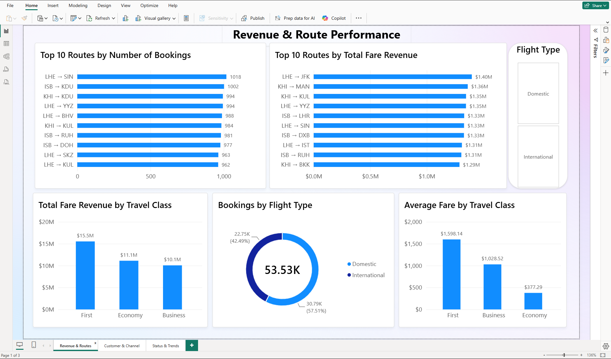
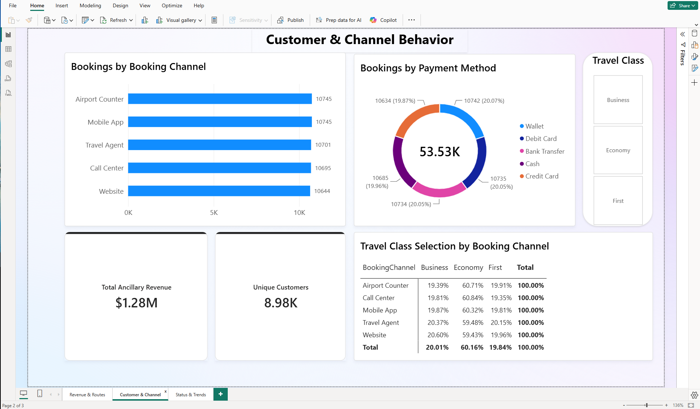
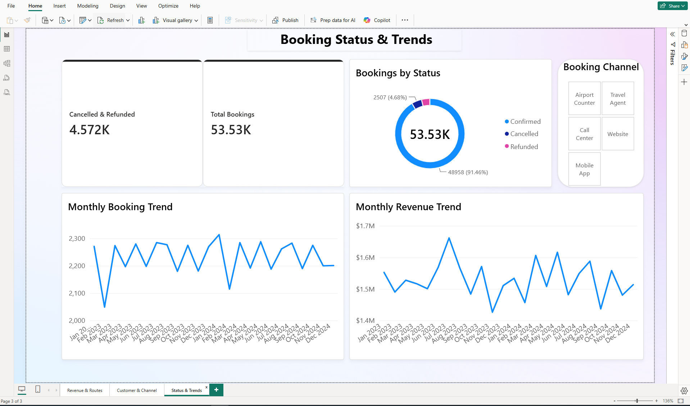
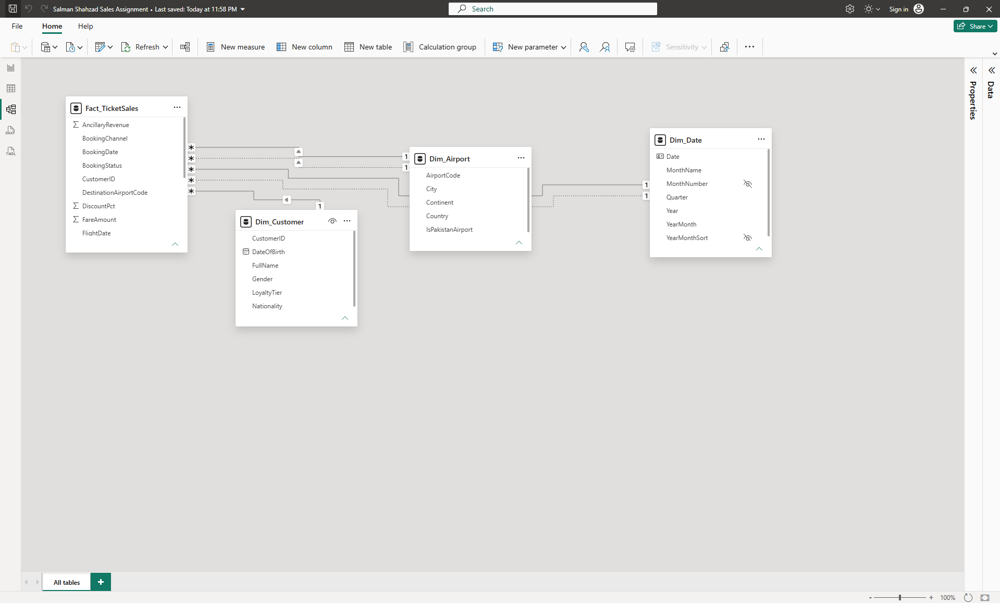

# ✈️ AeroPak Airlines — Sales & Ticketing Dashboard (Power BI)

An end-to-end Power BI project: cleaning a raw airline ticketing export in Power Query, building a star-schema data model, and delivering a 3-page dashboard with a written findings report.

**Tools:** Power BI Desktop · Power Query (M) · Data Modeling  
**Dataset:** Simulated ticketing data for a fictional airline. ~54,000 bookings · ~9,000 customers · 26 airports (2023–2024)

---

## 📊 Dashboard

### Page 1 — Revenue & Route Performance

### Page 2 — Customer & Channel Behavior

### Page 3 — Booking Status & Trends

---

## 🧹 Data Cleaning (Power Query)

| Issue | Fix |
|---|---|
| Mixed casing in BookingChannel, TravelClass, FlightType (`CALL CENTER`, `call center`) | Trim + Capitalize Each Word |
| FlightType abbreviations (`Intl`) | Replaced with `International` |
| FareAmount stored as mixed text (`USD 1,171`, `$2,691.61`, `435.51`) | Removed `USD`, `$` and `,`, converted to decimal |
| Floating-point noise (`78.43000000000001`) | Rounded to 2 decimals |
| Lowercase airport codes (`lhe`, `yyz`) | Converted to uppercase to match Dim_Airport |
| Duplicate ticket records | Removed duplicates on TicketID |
| Orphaned CustomerID (`CUS-99999`) not in Dim_Customer | Removed rows |
| Data types | Set dates, decimals, percentages and text on every column |

---

## 🗂️ Data Model

- Star schema: `Fact_TicketSales` with `Dim_Customer`, `Dim_Airport` and `Dim_Date`
- All relationships are one-to-many with single-direction filtering
- `Dim_Airport` is a role-playing dimension: **Origin** is active and **Destination** is inactive
- `Dim_Date` was built in Power Query and marked as the date table. **BookingDate** is active and **FlightDate** is inactive
- A `Route` column (Origin → Destination) was added in Power Query to analyze routes

---

## 🔍 Key Findings

- **53,530 bookings** after cleaning. **8.54%** were cancelled or refunded.
- **International flights drive revenue.** They are 42.5% of bookings, but all top 10 revenue routes are international, led by LHE → JFK ($1.40M).
- **First class leads revenue ($15.5M). Business is lowest ($10.1M),** even though Business and First each have about 20% of bookings.
- **Booking volume is flat** at about 73 bookings a day. Month-to-month swings follow the number of days in each month.
- **Booking channels and payment methods are evenly split,** each at about 20%.

*Revenue figures are based on Confirmed bookings only.*

---

## 📁 Files

| File | Description |
|---|---|
| `AeroPak_Sales_Dashboard.pbix` | Power BI file: cleaned data, model and dashboard |
| `AeroPak_Sales_Findings_Report.pdf` | Findings report: assumptions, insights and recommendations |

## 👤 Author

**Salman Shahzad** — Data Analyst  

